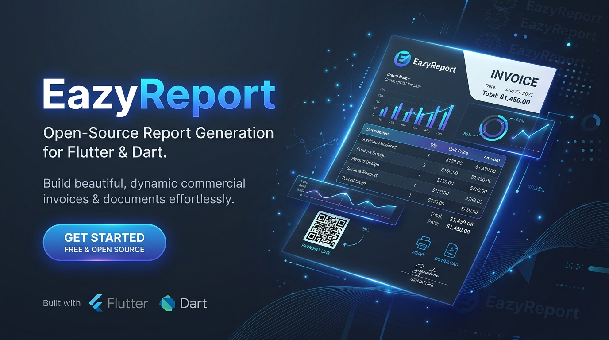

<p align="center">
  
</p>

<h1 align="center">EazyReport for PHP & Laravel</h1>

<p align="center">
  <strong>High-performance, pure PHP report generation engine supporting visual <code>.rtpl</code> templates designed at <a href="https://eazyreport.in/">eazyreport.in</a>.</strong>
</p>

<p align="center">
  <a href="https://github.com/ashiq-kodali/eazyreport-php/actions"></a>
  <a href="https://packagist.org/packages/ashiq-kodali/eazyreport"></a>
  <a href="https://packagist.org/packages/ashiq-kodali/eazyreport"></a>
  <a href="LICENSE"></a>
  <a href="https://php.net"></a>
</p>

---

## 🌟 Overview

**EazyReport** is an enterprise-grade report engine built specifically for PHP 8.1+ and Laravel. It allows developers to bind database collections, Eloquent models, or array datasets directly into visual templates (`.rtpl`) created with the drag-and-drop web designer at [https://eazyreport.in/](https://eazyreport.in/).

Generate pixel-perfect **HTML**, **print previews**, and vector **PDF** documents with zero external dependencies, or seamlessly scale with Dompdf for PDF workflows.

---

## 🚀 Key Features

- **Visual Designer Ready**: Natively load and execute `.rtpl` (v2) template files designed on [https://eazyreport.in/](https://eazyreport.in/).
- **Multi-Band Layout Architecture**: Supports Report Title, Report Summary, Page Header, Page Footer, Column Header, Column Footer, Data Bands, and Child Bands with automatic multi-page pagination.
- **Dynamic Content Growth**: Automatically measures and expands text boxes (`autoHeight`, `canGrow`) across page breaks while keeping headers and footers intact.
- **Built-in Barcode & 2D QR Code Generation**: Pure vector SVG barcode generation (Code 128, QR Code) without requiring heavy C extensions.
- **Pure SVG Charting**: Embed beautiful column, bar, line, area, pie, and doughnut charts directly in your reports.
- **Robust Expression Engine**: Full Handlebars syntax (`{{field}}`, `{{#if}}`, `{{#each}}`), 35+ formatting helpers (`currency`, `number`, `words`, `date`), and arithmetic formula evaluation.
- **Laravel Auto-Discovery**: First-class Laravel service provider, `@eazyreport` Blade directive, and facade integration.
- **Zero-Dependency Vector PDF**: Generates valid PDF 1.4 documents out of the box, with automatic Dompdf adapter support when installed.

---

## 📦 Installation

Install via Composer:

```bash
composer require ashiq-kodali/eazyreport
```

For enhanced PDF rendering with full CSS/SVG support, you can optionally include Dompdf:

```bash
composer require dompdf/dompdf
```

---

## ⚡ Quick Start

### 1. Standalone / Vanilla PHP

```php
use EazyReport\EazyReport;

// Load template and bind data
$builder = EazyReport::load('path/to/invoice.rtpl')
    ->data([
        'invoice' => [
            'number' => 'INV-2026-001',
            'date' => '2026-10-03',
            'dueDate' => '2026-10-17',
        ],
        'customer' => [
            'name' => 'Acme Corporation',
            'address' => '100 Innovation Way',
            'city' => 'San Francisco, CA',
        ],
        'items' => [
            ['description' => 'Enterprise Cloud Hosting', 'qty' => 12, 'rate' => 250.0, 'amount' => 3000.0],
            ['description' => 'Dedicated Migration Support', 'qty' => 40, 'rate' => 85.0, 'amount' => 3400.0],
        ],
        'totals' => [
            'subtotal' => 6400.0,
            'tax' => 512.0,
            'total' => 6912.0,
        ],
    ])
    ->param('currency', 'USD');

// 1. Generate standalone HTML for browser viewing or printing
$html = $builder->toHtml();

// 2. Generate PDF binary bytes
$pdfBytes = $builder->toPdf();

// 3. Save to disk
$builder->savePdf('storage/reports/invoice.pdf');

// 4. Stream or download directly in HTTP response
$builder->downloadPdf('invoice-INV-2026-001.pdf');
```

---

### 2. Laravel Integration

EazyReport automatically registers its ServiceProvider and Facade in Laravel.

#### Controller Example:

```php
namespace App\Http\Controllers;

use EazyReport\Laravel\Facades\EazyReport;
use App\Models\Order;
use Illuminate\Http\Response;

class InvoiceController extends Controller
{
    public function download(Order $order)
    {
        $templatePath = resource_path('reports/invoice.rtpl');

        $pdf = EazyReport::load($templatePath)
            ->data([
                'order' => $order->toArray(),
                'customer' => $order->customer->toArray(),
                'items' => $order->items->toArray(),
            ])
            ->param('printedBy', auth()->user()->name ?? 'System')
            ->toPdf();

        return response($pdf, 200, [
            'Content-Type' => 'application/pdf',
            'Content-Disposition' => 'attachment; filename="order-' . $order->id . '.pdf"',
        ]);
    }
}
```

#### Blade Directive:

Embed a report preview directly inside any Blade view:

```blade
<div class="report-wrapper">
    @eazyreport(resource_path('reports/invoice.rtpl'), $invoiceData)
</div>
```

---

## 💼 Real-World Use Cases

| Use Case | Description | Highlights |
| :--- | :--- | :--- |
| **Commercial Invoicing & Billing** | Multi-item billing with automated tax calculation, currency formatting, and currency amounts in words. | `{{words total}}`, `{{currency amount}}`, Code 128 barcodes |
| **Logistics & Shipping Manifests** | High-density shipping waybills with parcel barcodes and 2D QR codes for instant warehouse scanning. | Native QR codes, fixed-height rows, fill-unused-space bands |
| **Executive & Financial Dashboards** | Management reports complete with revenue summaries and embedded vector charts. | SVG Column, Bar, Line, and Doughnut charts |
| **Academic & Training Certificates** | Landscape-oriented credential certificates with custom typography and subtle background watermarks. | Landscape orientation, dynamic watermarks, vector shapes |

---

## 🧮 Expressions & Helper Reference

EazyReport supports rich Handlebars expressions and over 35 built-in helper functions:

```handlebars
{{! Formatting Helpers }}
{{currency total '$' 2}}           <!-- $1,234.50 -->
{{number count 0}}                <!-- 1,000 -->
{{words total}}                   <!-- One Thousand Two Hundred Thirty-Four and 50/100 -->
{{date createdAt 'Y-m-d'}}        <!-- 2026-10-03 -->

{{! Text Helpers }}
{{upper customer.name}}           <!-- ACME CORP -->
{{lower status}}                  <!-- pending -->
{{capitalize title}}              <!-- Monthly Report -->

{{! Logic & Control Flow }}
{{#if isOverdue}}
    <span style="color: red;">PAYMENT OVERDUE</span>
{{/if}}

{{#each items}}
    Row: {{this.description}} - {{this.amount}}
{{/each}}
```

---

## 🎨 Visual Template Designer

Templates can be visually created and edited in your web browser:

👉 **[https://eazyreport.in/](https://eazyreport.in/)**

Design layouts with drag-and-drop precision, configure data bindings, style bands, and export `.rtpl` files ready for use with EazyReport in PHP, Laravel, Python, .NET, Flutter, and more!

---

## 👥 Contributors

- **Ashiq Kodali** ([@ashiq-kodali](https://github.com/ashiq-kodali))
- **Thameem PK**

---

## 📄 License

This package is open-sourced software licensed under the [MIT License](LICENSE).
